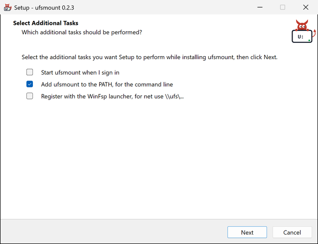

# ufsmount


Mount a FreeBSD UFS2 disk on Windows as a read-only drive.
Explorer, copy and robocopy work as on any drive.

Proven on real hardware: a 500 GB FreeBSD UFS2 USB disk with soft updates.
Its whole tree (about 20,000 files, 108 GB) lists correctly.
Plugging in, unplugging and Eject work too.

**Download:** [latest release](https://github.com/poeggi/ufsmount/releases/latest)
(setup, `SHA256SUMS`, licenses).
The command-line tool alone:
[ufsmount.exe](https://github.com/poeggi/ufsmount/releases/latest/download/ufsmount.exe).

## Requirements

- Windows 10 or 11, x64, an administrator account.
- [WinFsp](https://github.com/winfsp/winfsp/releases) 2.2.26286 (2026 Beta5) or later.
  Older versions have kernel vulnerabilities (CVE-2026-3006 and others).
  The setup downloads and installs it if needed.

## Install

Run `ufsmount-<version>-setup.exe`. It installs to `C:\Program Files\ufsmount`.



The setup is not signed:

- SmartScreen warns. Click "More info", then "Run anyway".
- Smart App Control (Windows 11) blocks it.
- Check the download: `Get-FileHash ufsmount-<version>-setup.exe` must match `SHA256SUMS`, ignoring case.

Silent install: `ufsmount-<version>-setup.exe /VERYSILENT /SUPPRESSMSGBOXES /NORESTART`.
An older version over a newer one then needs `/ALLOWDOWNGRADE`.

Uninstall: Settings > Apps > ufsmount. WinFsp stays installed.

## Start and stop

- Start: Start menu > ufsmount. The icon appears in the notification area.
- The user who ran the setup gets no UAC prompt. Other accounts get one.
- Every UFS2 file system is mounted: U: first, then T:, S: and so on.
- Plugging in a disk mounts it. Unplugging unmounts it.
- "Eject" (Safely Remove Hardware) works on a mounted disk: it is unmounted first.
- Right-click the icon: Open or Unmount a drive, Rescan disks, Quit (unmounts all).
- "Drive letter" in a drive's menu moves it to another letter. The letter is remembered for that file system.
- "Mount automatically" is on by default. Turned off, found file systems wait under "Not mounted".
  Unmounted ones wait there too. "Mount on" or "Mount as" mounts one.
- "Start at sign-in" in the icon's menu starts it at every sign-in. The setup has the same choice.
- About shows the versions. Each time it opens, it asks GitHub whether a newer release exists.
  Nothing is downloaded.
- Log: `C:\ProgramData\ufsmount\tray\tray.log`.

## Disks

- Any disk Windows sees: SATA, eSATA, NVMe, USB disks and sticks, card readers, iSCSI.
- Optical drives too, not yet tested on real hardware.
- Sectors of 512 or 4096 bytes, 2048 on discs.
- A disk partitioned with 512-byte sectors works behind a 4096-byte USB bridge, and the other way round.
- File systems from FreeBSD, NetBSD (FFSv2, FFSv2ea) and OpenBSD.
- GPT and MBR partitions, also logical MBR partitions.
- BSD labels in an MBR or GPT partition, or at the disk start.
- Apple Partition Maps (PowerPC Macs).
- A file system without any partition table.

## Command line

Use an elevated prompt. The setup adds the folder to PATH.

```
ufsmount probe PhysicalDrive1
ufsmount mount PhysicalDrive1 U:
ufsmount ls PhysicalDrive1 /home
ufsmount cp PhysicalDrive1 /home/me D:\backup
```

- `Get-Disk` shows the disk number. `probe` lists partitions and UFS file systems.
- Optical drives are `CdRom0`, `CdRom1` and so on.
- `mount` keeps U: until Ctrl+C or until the window closes.
- `--part s1a` picks a partition when a disk has several.
- An image file works in place of the disk: `ufsmount mount disk.img U:`.

The WinFsp launcher (`net use`) mounts without an open window:

```
ufsmount register
net use U: \\ufs\PhysicalDrive1 /persistent:no
net use U: /delete
```

- Run `register` once. All three need an elevated prompt.
- The launcher takes disks (`PhysicalDriveN`), not optical drives.
- `register` needs `ufsmount.exe` under `C:\Program Files`, as the setup installs it.
- Windows keeps `net use` drives per logon.
  Explorer does not see a drive mapped in an elevated prompt. Use `mount` for that.

## Limits

- Read-only. UFS1 is not supported.
- Not read: DragonFly's disklabel64, geli (encrypted), gconcat, gstripe, gvinum.
- A file system that was not unmounted cleanly is read as is.
- A bad sector fails only the files that use it.
- Names Windows cannot show (`:`, `?`, invalid UTF-8, ...) map to private-use characters.
  `--charset latin1` shows non-UTF-8 names as Latin-1.
- Names are case-sensitive, also in wildcards (`dir *.TXT`). Another case works if the match is unique.
- Symlinks are Windows symlinks. Use `robocopy /XJ` or `/SL` to avoid loops.
- Device nodes, fifos and sockets are hidden.

## Build

Needs Rust stable, Visual Studio Build Tools (C++) and LLVM (libclang).
The setup needs [Inno Setup](https://jrsoftware.org/isinfo.php) 7.1.1.

```
cargo build --release
cargo test
ISCC /DAppVersion=<version> products\ufsmount\installer.iss
```

The setup goes to `temp\installer`. `UFSMOUNT_MOUNT_TEST=1` enables the WinFsp mount tests.

The code is in two parts.
`crates/win-mountkit` is the shared part: disks, WinFsp, the command line and the tray.
It names no file system.
`products/ufsmount` holds the UFS code, the names, texts, logo and setup settings.
Another read-only file system could reuse the shared part with its own product folder.

## Credits

- WinFsp - Windows File System Proxy, Copyright (C) Bill Zissimopoulos.
  https://github.com/winfsp/winfsp
- [rufs / fuse-ufs](https://github.com/realchonk/fuse-ufs) by Benjamin Stuerz and contributors (BSD-2-Clause).
- [winfsp-rs](https://github.com/SnowflakePowered/winfsp-rs) by SnowflakePowered and contributors (GPL-3.0).
- The daemon in the logo is a nod to the BSD Daemon by Marshall Kirk McKusick.

## License

AGPL-3.0-or-later, see `LICENSE`.
`vendor/fuse-ufs` keeps its BSD-2-Clause license.
